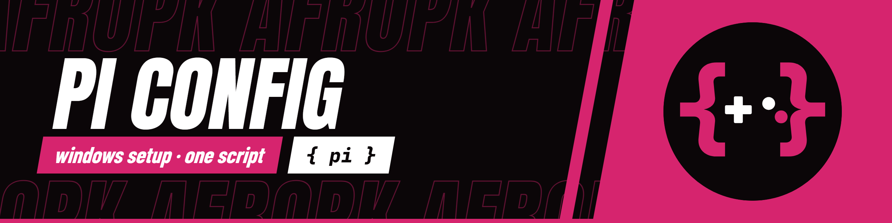
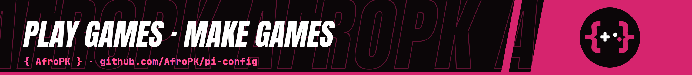

<p align="center">
  
</p>

<p align="center">
  
  
  
  
</p>

<p></p>

**`{ pi-config }`**: my whole Pi setup, sanitized and in one repo, with an installer that puts it back.

218 captured files, 32 skills, 11 local extension entry points, 12 Pi packages and the llama-swap/Strata profiles they run on. It's the active configuration, not old backups. Restore it on a fresh Windows box and you get the same agent back.

> [!NOTE]
> No keys, tokens, sessions or logs are committed. Provider keys in `models.json` are environment-variable references. Run the verification script before publishing.

<p></p>

**Needs:** Git · Node.js 22.19+ · npm · PowerShell 5.1+ · Python 3.12

```powershell
git clone https://github.com/AfroPK/pi-config.git
cd pi-config
powershell -NoProfile -ExecutionPolicy Bypass -File .\scripts\install.ps1
python .\scripts\verify.py --installed-home $HOME
```

1. The installer backs up every file it would replace to `~/.pi-config-backups/<timestamp>/`.
2. It restores `config/agent/` to `~/.pi/agent/` and `config/pi/` to `~/.pi/`, swapping `__PI_HOME__` for your home path.
3. It installs Pi 1.6.0 and the core global tools, then installs exact package versions from each `package-lock.json`.
4. It reapplies the local `pi-ghost-text` patch and prepares `pi-interactive-subagents` (LF checkout + Windows patch).
5. Restart the terminal, start Pi, run `/login` for OpenRouter.

Files-only restore: add `-SkipPackages -SkipPiInstall`. Machine integrations (llama-swap, Strata, llama.cpp launchers): `-IncludeMachineIntegrations`. Test home: `-DestinationHome C:\Temp\pi-restore-test`.

<p></p>

| Area | Path | Contents |
|---|---|---|
| Core preferences | `config/agent/settings.json` | Theme, default/scoped models, thinking budgets, compaction, packages, MCP adapter |
| Model endpoints | `config/agent/models.json` | OpenRouter overrides, OmniRoute, five local models, two Kaggle tunnels |
| MCP | `config/agent/mcp.json` | Context7, Firecrawl, Aseprite, DaVinci Resolve, Retro Diffusion, Browse |
| Global instructions | `config/agent/AGENTS.md` | Engineering rules, verification, safety, Git and tool conventions |
| Extensions | `config/agent/extensions/` | Browser, web search/fetch, vision, image generation, Claude CLI, guards, snippets |
| Skills | `config/agent/skills/` | All 32 active skills with scripts, references, tests and templates |
| Subagent definitions | `config/agent/agents/` | `scout`, `researcher`, `worker` on DeepSeek v4.1 flash, `xhigh` |
| Patches | `config/agent/patches/` | Ghost-text patches and renderer, pi-interactive-subagents Windows patch |
| Machine integration | `config/machine/` | llama-swap config, three model launch profiles, Strata config, process cleanup |

<p></p>

```bash
pi                    # default model
pi-models strata      # local Strata Gyro-S, vision-capable
pi-models qwen36      # local Qwen3.6 35B-A3B IQ3 executor
pi-plan "task"        # scoped PLAN.md using Strata
pi-review             # fresh review of PLAN.md
pi-exec               # execute PLAN.md using Qwen3.6
pi-pe "task"          # plan -> review -> execute
pi-loop TASK.md       # unattended plan/review/execute/code-review loop
```

In-session: `/model`, `/thinking`, `/settings`, `/reload`, `/snippets`, `/browser on`, `/claude-cli`, `/mcp`. `pi config` lists loaded resources.

<p></p>

- [Full restoration guide](docs/RESTORE.md) — prerequisites, install order, rollback, post-restore checks.
- [Configuration reference](docs/CONFIGURATION.md) — every settings area, model, extension, package, skill, launcher and patch.
- [Secrets and authentication](docs/SECRETS.md) — required variables and safe sign-in.
- [External services](docs/EXTERNAL-SERVICES.md) — what copying Pi files alone can't reproduce.
- [Maintenance](docs/MAINTENANCE.md) — recapture, sanitize, verify, publish.
- [Inventory](docs/INVENTORY.md) — exactly what was and wasn't captured.

<p></p>

- The snapshot is Windows-specific. The `.cmd` launchers, PowerShell scripts, drive layout and ROCm settings need adapting for macOS or Linux.
- Locked versions are for reproducibility, not a claim of zero vulnerabilities. `npm audit` reported 3 high in the Pi package tree, 1 critical in bash-guard's `shell-quote` and 1 low in web-fetch's `@mozilla/readability` at capture time. The installer never runs `npm audit fix`.
- Verify before publishing: `python scripts/verify.py` and `python -m unittest discover -s tests -v`.
- Captured 2026-11-21 · Pi 1.6.0 · Node 26.13.1.

<p align="center">
  
</p>
